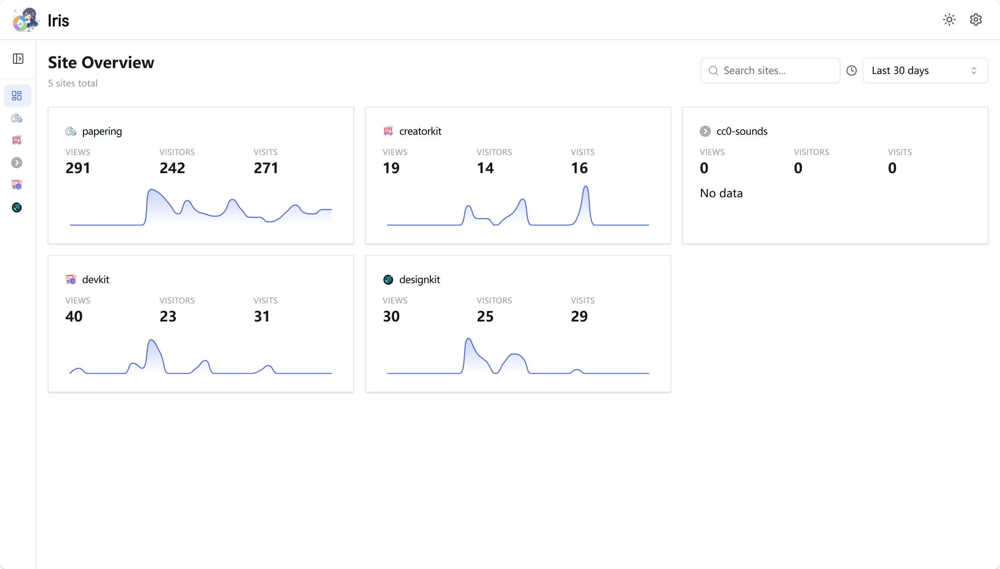

<p align="center">

</p>

<h2 align="center">Iris Analytics</h2>

<p align="center">A lightweight, open-source website analytics dashboard powered by Cloudflare Pages + Analytics Engine</p>

<p align="center">
  <a href="https://iris.exi.software/">Demo</a> ·
  <a href="#deployment">Deployment</a> ·
  <a href="https://exi.ink/posts/cloudflare-page%E9%83%A8%E7%BD%B2iris-analytics%E7%BD%91%E7%AB%99%E5%88%86%E6%9E%90/">Deployment Guide (Chinese)</a>
</p>

<p align="center">
  <a href="README.zh-CN.md">简体中文</a>
</p>

## Introduction

Iris Analytics is a website analytics tool rebuilt from [HanAnalytics](https://github.com/uxiaohan/HanAnalytics), offering a clearer and more intuitive data overview with an improved user experience.

No database required — fully powered by the Cloudflare ecosystem:

- **Pages** — Hosts the frontend and API (Pages Functions)
- **Workers Analytics Engine** — Time-series database for storing analytics data



## Prerequisites

- Log in to [Cloudflare](https://dash.cloudflare.com/)
- Cloudflare Account ID (available on the Workers & Pages page)
- [Cloudflare API Token](https://dash.cloudflare.com/profile/api-tokens) with **Account Analytics Read** permission
- Create a dataset in **Analytics Engine** with binding name `AnalyticsBinding` and dataset name `AnalyticsDataset`

## Deployment

1. Fork this repository or [use it as a template](https://github.com/new?template_name=IrisAnalytics&template_owner=rowink)
2. Create a Cloudflare Pages project, select your forked repo, choose **Vue** framework, fill in the [environment variables](#environment-variables), and deploy
3. In your Pages project **Settings > Bindings**, add an **Analytics Engine** binding with variable name `AnalyticsBinding` and dataset `AnalyticsDataset`, then redeploy
4. Visit `https://your-project.pages.dev` to access the analytics dashboard
5. Go to **Settings > Integration** to get the tracking script and add it to your site
6. Return to the dashboard and wait for visit data.

### Environment Variables

| Variable                       | Description                                                                                                        | Required |
| ------------------------------ | ------------------------------------------------------------------------------------------------------------------ | -------- |
| `CLOUDFLARE_ACCOUNT_ID`        | Cloudflare Account ID                                                                                              | Yes      |
| `CLOUDFLARE_API_TOKEN`         | Cloudflare API Token (Account Analytics Read permission)                                                           | Yes      |
| `CLOUDFLARE_WEBSITE_PWD`       | Dashboard access password (leave empty for no password)                                                            | No       |
| `CLOUDFLARE_WEBSITE_WHITELIST` | Analytics whitelist — format: `WebsiteID \| domain`, newline- or comma-separated                                   | No       |
| `CLOUDFLARE_IP_BLACKLIST`      | IP blacklist — exact IP, CIDR range, or wildcard (`1.2.3.4`, `1.2.3.0/24`, `1.2.3.*`), comma- or newline-separated | No       |

### Analytics Engine Binding

```shell
# Binding name
AnalyticsBinding
# Dataset name
AnalyticsDataset
```

### Tracking Script

Insert the following code at the bottom of your website to integrate analytics:

```html
<script defer src="https://your-project.pages.dev/tracker.min.js" data-website-id="your-unique-site-id"></script>
```

## Whitelist

By default, the analytics API is public — any site can send data to the dataset. The whitelist provides two-way verification of both the site ID and domain to prevent data pollution.

```shell
# Recommended: comma-separated (single line) — avoids the Cloudflare env var UI stripping newlines
CLOUDFLARE_WEBSITE_WHITELIST = website-id | domain.com, iris | iris.exi.software
```

Newline-separated rules are also supported (one rule per line, or a mixed format with each line ending in a comma). However, since Cloudflare's page may change and newlines could be lost, making the config hard to edit later, this configuration style is not recommended. If you do use it, it's recommended to end each rule with a comma.

```shell
# Format: WebsiteID | domain, newline-separated
CLOUDFLARE_WEBSITE_WHITELIST =
website-id | domain.com
iris | iris.exi.software
...

# Format: WebsiteID | domain, mixed newline-separated with trailing commas
CLOUDFLARE_WEBSITE_WHITELIST =
website-id | domain.com,
iris | iris.exi.software,
...
```

The whitelist validates both the unique site ID and domain, ensuring only authorized websites can report data.

## IP Blacklist

Visits from blacklisted IPs are silently ignored by the tracking endpoint — they are never written to the Analytics Engine, the same as bot filtering. Useful for excluding your own IP, datacenter ranges, or abusive scanners.

```shell
# Recommended: comma-separated (single line)
CLOUDFLARE_IP_BLACKLIST = 1.2.3.4, 10.0.0.0/8, 192.168.1.*, 2001:db8::/32
```

Supported rule syntax (comma- or newline-separated, one rule per entry):

- Exact IPv4: `1.2.3.4`
- IPv4 CIDR range: `1.2.3.0/24`
- IPv4 wildcard (per octet): `1.2.3.*`, `10.*.*.*`, or `*` to match any IP
- Exact IPv6: `2001:db8::1`
- IPv6 CIDR: `2001:db8::/32`

IPv4 and IPv4-mapped IPv6 addresses (e.g. `::ffff:1.2.3.4`) are treated as equivalent. Invalid entries are skipped and logged as warnings.

## Authentication

Set the `CLOUDFLARE_WEBSITE_PWD` environment variable to require a password for dashboard access. The login session lasts for 7 days and auto-renews on active visits.

```shell
# Set a password to protect the dashboard (no password by default)
CLOUDFLARE_WEBSITE_PWD = your_password
```

## Gratitude

- [HanAnalytics](https://github.com/uxiaohan/HanAnalytics)

## License

The project is licensed under the [MIT](LICENSE).
